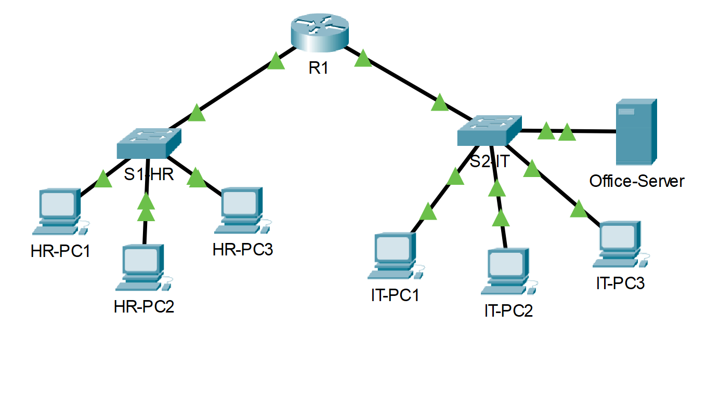
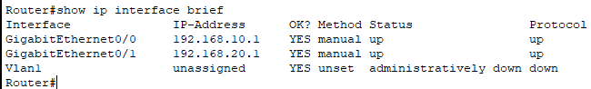
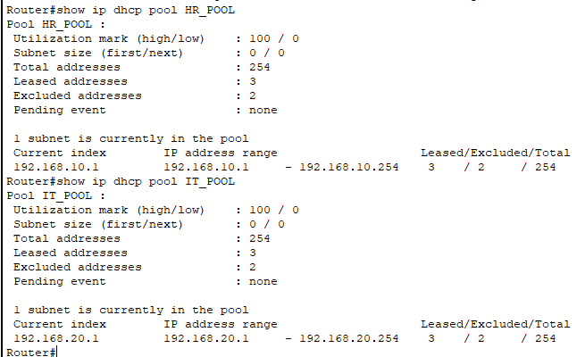
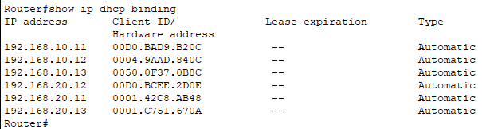
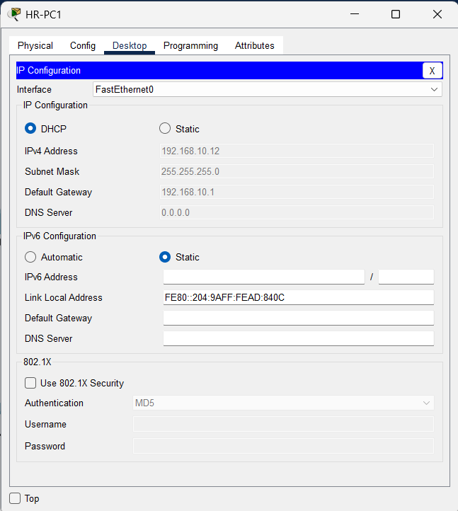
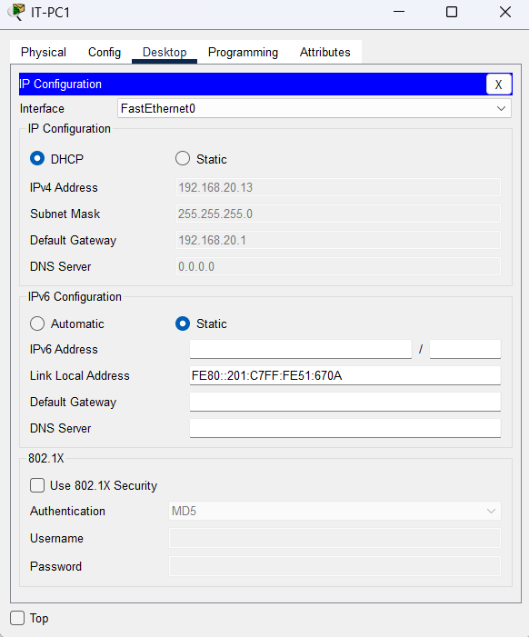
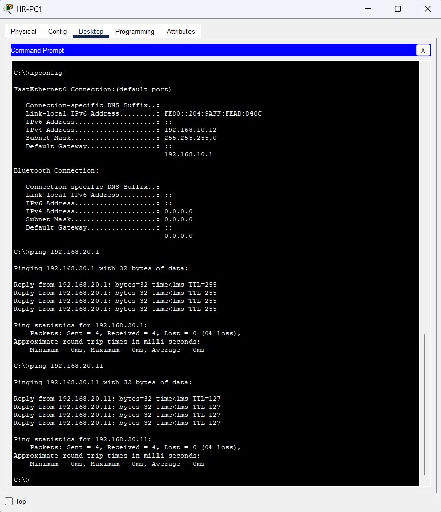
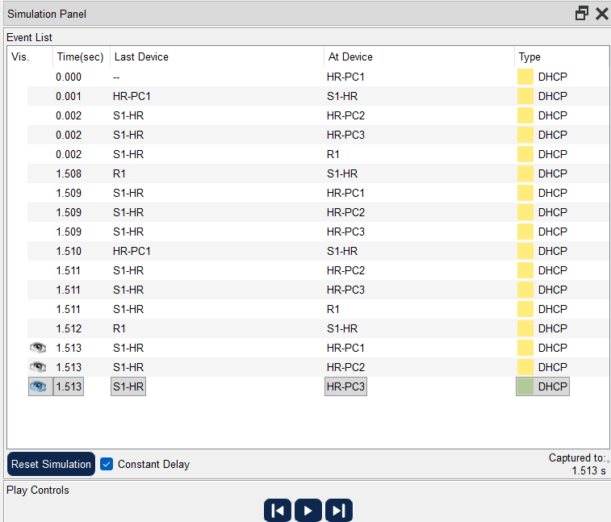
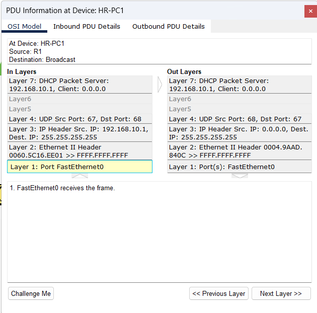
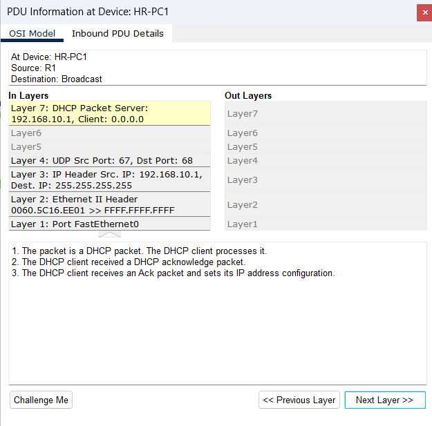

# Small Office Network Design | Cisco Packet Tracer

A hands-on networking project focused on designing, configuring, and troubleshooting a small office network with separate Human Resources (HR) and Information Technology (IT) departments using Cisco Packet Tracer.

The project demonstrates practical networking concepts including IPv4 addressing, subnetting, DHCP configuration, inter-subnet routing, ARP, packet simulation, and network troubleshooting.

<p align="center">
  
</p>

<p align="center">
  <strong>Network topology connecting two departmental LANs through a Cisco router.</strong>
</p>

---

## Table of Contents

- [Project Overview](#project-overview)
- [Objectives](#project-objectives)
- [Network Architecture](#network-architecture)
- [IP Addressing Scheme](#ip-addressing-scheme)
- [Network Configuration](#network-configuration)
- [DHCP Implementation](#dhcp-implementation)
- [Connectivity and Network Testing](#connectivity-and-network-testing)
- [DHCP Packet Simulation](#dhcp-packet-simulation)
- [Troubleshooting Scenarios](#troubleshooting-scenarios)
- [Technologies and Concepts](#technologies-and-concepts)
- [Project Structure](#project-structure)
- [How to Run the Project](#how-to-run-the-project)
- [Key Learnings](#key-learnings)
- [Future Improvements](#future-improvements)

---

## Project Overview

This project simulates the network infrastructure of a small organization with two departments:

- **Human Resources (HR):** A dedicated departmental LAN.
- **Information Technology (IT):** A separate departmental LAN.

A Cisco router connects both networks through two physical GigabitEthernet interfaces. Each department has its own switch and DHCP address pool, allowing client devices to obtain IP configurations automatically.

An office server is connected to the IT network and configured with a static IPv4 address.

The network was configured and tested in Cisco Packet Tracer to verify communication within each LAN and between the two different subnets.

## Project Objectives

- Design a small office network with separate departmental networks.
- Configure IPv4 addressing and subnet masks.
- Configure DHCP pools for automatic IP address allocation.
- Configure router interfaces and default gateways.
- Enable communication between different subnets through routing.
- Configure a server with a static IP address.
- Analyze DHCP packet exchanges using Simulation Mode.
- Perform connectivity tests using ICMP ping.
- Troubleshoot common network configuration failures.

## Network Architecture

The network consists of:

| Device | Quantity | Purpose |
|---|---:|---|
| Cisco Router (R1) | 1 | Connects HR and IT networks |
| Cisco Switch (S1-HR) | 1 | Connects HR client devices |
| Cisco Switch (S2-IT) | 1 | Connects IT client devices and server |
| HR PCs | 3 | HR departmental endpoints |
| IT PCs | 3 | IT departmental endpoints |
| Office Server | 1 | Server with static IP configuration |

**Total devices: 10**

### Network topology

The router uses two physical interfaces to connect the two departmental LANs:

- GigabitEthernet0/0 connects to the HR network.
- GigabitEthernet0/1 connects to the IT network.

Each department operates on a different IPv4 subnet.

## IP Addressing Scheme

The network uses two separate `/24` IPv4 networks.

| Network Component | HR Department | IT Department |
|---|---|---|
| Network Address | 192.168.10.0/24 | 192.168.20.0/24 |
| Subnet Mask | 255.255.255.0 | 255.255.255.0 |
| Default Gateway | 192.168.10.1 | 192.168.20.1 |
| DHCP Pool | HR_POOL | IT_POOL |
| Router Interface | G0/0 | G0/1 |

### Device addressing

| Device | IP Address | Assignment |
|---|---|---|
| R1 - G0/0 | 192.168.10.1 | Static |
| R1 - G0/1 | 192.168.20.1 | Static |
| HR-PC1 | 192.168.10.12 | DHCP |
| HR-PC2 | 192.168.10.11 | DHCP |
| HR-PC3 | 192.168.10.13 | DHCP |
| IT-PC1 | 192.168.20.13 | DHCP |
| IT-PC2 | 192.168.20.12 | DHCP |
| IT-PC3 | 192.168.20.11 | DHCP |
| Office Server | 192.168.20.10 | Static |

*DHCP client addresses reflect the leases observed during project testing. DHCP assignments can change when leases are renewed.*

### Subnetting

Both departmental networks use a `/24` prefix.

- Total IPv4 addresses per subnet: 256
- Usable host addresses per subnet: 254
- Network address: Reserved
- Broadcast address: Reserved

The separate subnets provide independent IP addressing and allow the router to route traffic between the departments.

## Network Configuration

### 1. Router interface configuration

Configured the router interfaces with their respective gateway addresses.

```bash
enable
configure terminal

interface gigabitEthernet 0/0
ip address 192.168.10.1 255.255.255.0
no shutdown
exit

interface gigabitEthernet 0/1
ip address 192.168.20.1 255.255.255.0
no shutdown
exit

end
```

Both router interfaces were verified using:

```bash
show ip interface brief
```

### Router interface verification



Both GigabitEthernet interfaces were verified as `up/up`.

### 2. DHCP configuration

Configured two independent DHCP pools on the router to provide automatic IPv4 configuration to departmental clients.

**Excluded addresses:**

```bash
ip dhcp excluded-address 192.168.10.1 192.168.10.10
ip dhcp excluded-address 192.168.20.1 192.168.20.10
```

These addresses are reserved from automatic DHCP allocation.

**HR DHCP pool:**

```bash
ip dhcp pool HR_POOL
network 192.168.10.0 255.255.255.0
default-router 192.168.10.1
exit
```

**IT DHCP pool:**

```bash
ip dhcp pool IT_POOL
network 192.168.20.0 255.255.255.0
default-router 192.168.20.1
exit
```

### DHCP pool verification

Used the following commands to inspect the configured DHCP pools:

```bash
show ip dhcp pool HR_POOL
show ip dhcp pool IT_POOL
```



### DHCP binding verification

Verified dynamically assigned IP addresses and their associated client MAC addresses using:

```bash
show ip dhcp binding
```



### 3. End-device configuration

HR and IT client devices were configured to obtain their IPv4 addresses automatically through DHCP.

**HR client configuration:**



**IT client configuration:**



### 4. Office server configuration

The office server was assigned a static IPv4 configuration:

| Parameter | Value |
|---|---|
| IPv4 Address | 192.168.20.10 |
| Subnet Mask | 255.255.255.0 |
| Default Gateway | 192.168.20.1 |
| DNS Server | Not configured |

The server is connected to the IT switch and can be accessed from the HR network through the router.

## Connectivity and Network Testing

After configuring the router, DHCP pools, and client devices, connectivity was tested using the Windows command prompt available in Packet Tracer.

### IP configuration verification

```bash
ipconfig
```

Verified the assigned IPv4 address, subnet mask, and default gateway.

### ICMP connectivity testing

**Test 1: HR-PC1 to IT default gateway**

```bash
ping 192.168.20.1
```

Result: Successful.

**Test 2: HR-PC1 to IT-PC3**

```bash
ping 192.168.20.11
```

Result: Successful.


### Connectivity test evidence



Successful ping responses verified communication between the HR and IT networks.

## DHCP Packet Simulation

Used Cisco Packet Tracer Simulation Mode to observe DHCP packet exchanges between the client, switch, and router.

The DHCP address allocation process follows four stages:

| Stage | DHCP Message | Description |
|---|---|---|
| 1 | Discover | Client broadcasts a request to locate a DHCP server. |
| 2 | Offer | DHCP server offers an available IP configuration. |
| 3 | Request | Client requests the offered configuration. |
| 4 | Acknowledgement (ACK) | Server confirms the lease and the client applies its configuration. |

### DHCP simulation event sequence



### DHCP packet details



### DHCP acknowledgement



The simulation confirmed that the DHCP client received an acknowledgement and applied its IP configuration.

## Troubleshooting Scenarios

Several fault scenarios were deliberately introduced and investigated to understand common networking failures.

### 1. DHCP service failure

**Scenario:** DHCP service was temporarily disabled on the router.

**Observed behaviour:**
- Client DHCP requests could not obtain an address from the router.
- Packet Tracer assigned an APIPA address in the `169.254.0.0/16` range.
- The default gateway remained `0.0.0.0`.
- Communication with devices outside the local link was unsuccessful.

**Resolution:** Restored DHCP service and renewed the client's DHCP configuration.

### 2. Incorrect default gateway

**Scenario:** An incorrect default gateway was configured on an HR client.

**Observed behaviour:**
- Communication within the same subnet continued to work.
- Communication with devices in the IT subnet failed.
- Return traffic could also fail because the client used an incorrect gateway.

**Resolution:** Restored the correct gateway address through DHCP.

### 3. Incorrect subnet mask

**Scenario:** An incorrect subnet mask was assigned to an HR client.

**Observed behaviour:**
- The client interpreted addresses in the IT subnet as local addresses.
- This affected how the client handled traffic intended for another subnet.
- Proxy ARP behaviour was observed during the experiment.

**Resolution:** Restored the correct `/24` subnet mask using DHCP and verified connectivity again.

### 4. DHCP address exhaustion experiment

**Scenario:** A temporary DHCP pool restriction was introduced to simulate address exhaustion.

**Observed behaviour:**
- The DHCP server could not allocate an available address when the pool was exhausted.
- The DHCP Discover packet was dropped at the router.
- The client continued using an APIPA address.

**Resolution:** Investigated DHCP exclusions and pool availability, restored the original DHCP configuration, and verified successful address allocation.

These exercises helped demonstrate the importance of checking DHCP configuration, IP addressing, subnet masks, and default gateways during network troubleshooting.

## Technologies and Concepts

**Tools**
- Cisco Packet Tracer

**Networking concepts**
- IPv4 addressing
- Subnetting and CIDR
- Subnet masks
- Default gateways
- DHCP
- Inter-subnet routing
- ARP
- ICMP and ping
- APIPA
- Proxy ARP
- Spanning Tree Protocol (STP)
- OSI model
- Packet analysis and simulation
- Network troubleshooting

## Project Structure

```text
small-office-network-design/
│
├── README.md
│
├── small-office-network-design.pkt
│
└── screenshots/
    ├── network-topology.png
    ├── router-interface-status.png
    ├── dhcp-pools.png
    ├── dhcp-bindings.png
    ├── hr-pc-ip-configuration.png
    ├── it-pc-ip-configuration.png
    ├── connectivity-test.png
    ├── dhcp-simulation-events.png
    ├── dhcp-packet-details.png
    └── dhcp-ack.png
```

## How to Run the Project

1. Clone or download this repository.

   ```bash
   git clone https://github.com/venu-3754/small-office-network-design.git
   ```

2. Open Cisco Packet Tracer.

3. Open the project file:

   `small-office-network-design.pkt`

4. Inspect the network topology and device connections.

5. Open the router CLI to review the interface and DHCP configuration.

6. Open individual PCs to inspect their IP configurations.

7. Use the command prompt to perform connectivity tests.

8. Switch to Simulation Mode to inspect network packet exchanges.

**Requirement:** Cisco Packet Tracer installed on your computer.

## Key Learnings

Through this hands-on project, I gained practical experience in:

- Designing a network with separate departmental subnets.
- Configuring Cisco router interfaces through CLI.
- Implementing DHCP pools for automatic IP allocation.
- Understanding the role of default gateways in inter-subnet communication.
- Verifying IP addressing and DHCP leases.
- Observing DHCP Discover, Offer, Request, and ACK messages.
- Understanding ARP resolution and Proxy ARP behaviour.
- Identifying the impact of incorrect subnet masks and gateways.
- Troubleshooting DHCP failures and address exhaustion.
- Validating network connectivity using ICMP ping.

## Future Improvements

The following enhancements are planned for future iterations:

- Implement VLAN-based departmental segmentation.
- Configure inter-VLAN routing using router-on-a-stick.
- Configure DNS services and test hostname resolution.
- Introduce Access Control Lists (ACLs) to control interdepartmental traffic.
- Implement a more structured IP addressing and subnet allocation plan.
- Explore network monitoring and logging.

---

## Author

**SONGA VENUGOPAL**

B.Tech | Cybersecurity

- GitHub: [@venu-3754](https://github.com/venu-3754)
- LinkedIn: [songavenugopal](https://linkedin.com/in/songavenugopal)

---

*This project was created as a practical learning exercise to strengthen my understanding of computer networking, Cisco device configuration, and network troubleshooting.*
